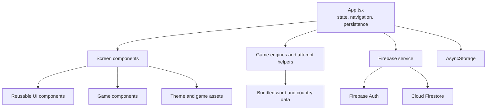
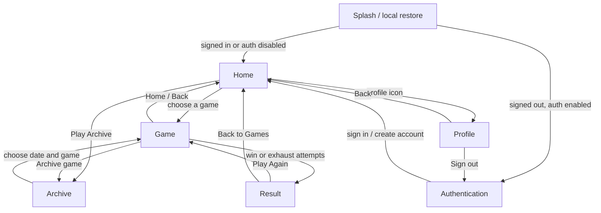
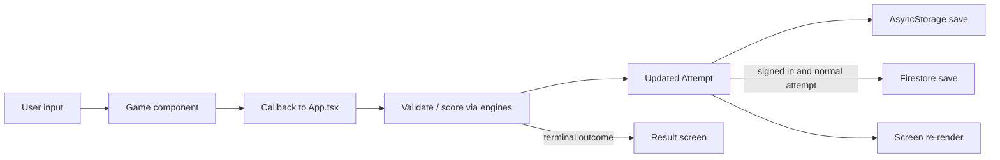
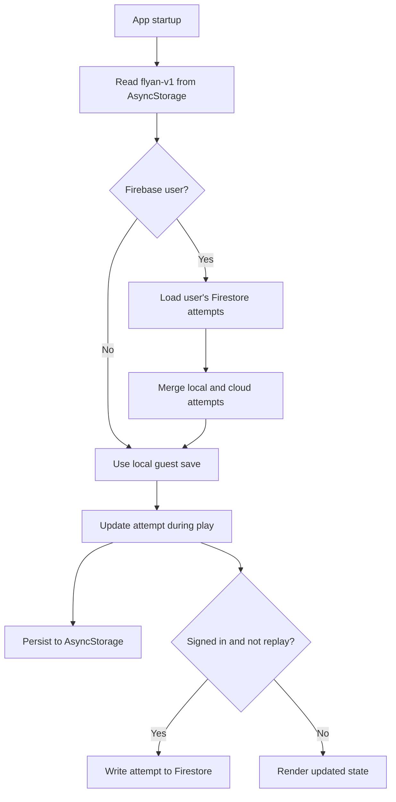

# Flyan technical specification

## 1. Project overview

Flyan is a portrait-oriented, local-first mobile puzzle app for iOS and Android. It is built with Expo SDK 58, React Native 0.88, and TypeScript. The app contains Wordle, Verticle, 6×6 Sudoku, and Worldle. Firebase Authentication and Cloud Firestore provide optional account sign-in and cross-device attempt sync; AsyncStorage remains the local persistence layer.

The implementation is a single React Native application. `App.tsx` owns navigation state, active attempts, app lifecycle, persistence, authentication, and the callbacks passed into screen components. There is no separate navigation library or backend server in this repository.

## 2. Runtime and dependencies

| Area                       | Implementation                                      |
| -------------------------- | --------------------------------------------------- |
| Mobile runtime             | Expo SDK 58, React Native 0.88, React 19            |
| Language                   | TypeScript 6                                        |
| Local persistence          | `@react-native-async-storage/async-storage`         |
| Identity and cloud storage | Firebase JS SDK: Authentication and Cloud Firestore |
| Vector country drawing     | `react-native-svg`                                  |
| Lint / formatting          | ESLint 9, Prettier 3                                |
| Test runner                | Node.js built-in test runner                        |

Install dependencies with `npm install`. `npm run start` launches Expo Go mode, `npm run android` and `npm run ios` launch native development builds, `npm test` runs the engine tests, and the typecheck/lint/format commands validate source consistency.

## 3. Architecture at a glance

The UI emits user actions through callbacks. `App.tsx` validates and applies the action, creates a new immutable attempt object, and persists it locally and (when authenticated and not in a temporary replay) to Firestore. Screens receive the resulting state through props and render it.

## 4. Navigation and screen flow

`App.tsx` implements a small state-driven screen router using the `Screen` union in `src/types/app.ts`. Only one main screen is rendered at a time. The `screen` state can be `splash`, `auth`, `home`, `archive`, `game`, `result`, or `profile`.

Archive dates before the current date can open archive attempts; future dates are disabled. The calendar covers the current month and the preceding two months. The archive screen uses a vertical `ScrollView` so its game rows remain reachable when additional games are enabled.

## 5. Gameplay and data flow

### Game rules

- **Wordle:** six guesses of five letters. The shared dictionary is `src/games/data/five-letter-words.json`. Exact letters are green, present letters yellow, absent letters grey. `scoreWord` handles duplicate letters; `keyboardFeedback` retains the strongest feedback for each key.
- **Verticle:** five guesses of five letters arranged column-wise. It uses a deterministic daily answer that differs from Wordle's answer for the same date. Feedback and keyboard share the Wordle design and colors.
- **Sudoku:** a randomized 6×6 puzzle with 2×3 boxes. The player enters digits 1–6 through the on-screen number pad. Entries are checked against the stored solution and row, column, and box rules. Undo and redo snapshots are kept on the attempt.
- **Worldle:** a bundled country dataset supplies names, aliases, coordinates, and outline paths. Suggestions filter as the player types. Wrong guesses display distance and one of eight compass directions. The round ends after six guesses.

Wordle and Verticle answer selection is deterministic by date, so clients agree on the same answer without a request to a server. Sudoku boards are randomized locally when a new attempt is created. Worldle country selection is also deterministic by puzzle date.

### Attempt model and persistence

`Attempt` in `src/types/app.ts` is the canonical saved game record. It stores status, date, mode (`daily` or `archive`), guesses/marks or Sudoku board state, move count, start/finish times, and accumulated active play time (`elapsedMs`). `Save` indexes these records by a stable key of the form `mode:date:game`.

`src/games/attempts.ts` creates attempt keys and initial attempts and computes the current consecutive daily win streak. Normal play updates the saved attempt; a replay of a completed attempt runs as a temporary session so its original terminal result is preserved.

AsyncStorage uses the key `flyan-v1`. Firestore stores attempt documents under `users/{uid}/attempts/{attemptKey}`. Because Firestore does not accept nested arrays, the complete attempt is serialized into `attemptJson`; scalar metadata fields are also written for filtering and inspection. Account documents live at `users/{uid}`.

### Timer lifecycle

The game timer measures active foreground time. It runs only while the game screen is open and the app is active. Leaving the game screen or backgrounding the app commits elapsed time and pauses the clock; returning resumes from `elapsedMs`. Terminal results freeze and retain the final time.

## 6. Authentication and cloud service

`src/services/firebase.ts` initializes Firebase from Expo public build-time variables named `EXPO_PUBLIC_FIREBASE_*`. Firebase Auth uses React Native AsyncStorage persistence. The service provides account creation, login, password reset, logout, attempt loading, attempt saving, and account-history synchronization.

Firebase client keys are public configuration and must not be treated as server secrets. Authorization must be enforced by Firestore Security Rules. `firestore.rules` is the checked-in rules file and `firebase.json` configures Firebase CLI resources. `docs/FIREBASE_SETUP.md` documents project setup. Cloud sync is best-effort; local progress is stored independently.

## 7. UI system and feature switches

`src/theme/colors.ts` defines the shared palette and `src/theme/styles.ts` defines reusable React Native styles. `src/components/ui/` contains common buttons, cards, labels, loading overlay, and replay confirmation. `src/components/games/` contains the puzzle boards and animated feedback cells/keys. `src/hooks/useFeedbackColor.ts` shares the eased color transition between Wordle-style tiles and keyboard keys.

`src/config/featureFlags.ts` is the build-time feature switchboard. Set a flag to `false` to hide or disable the associated feature. `isGameEnabled` centralizes game filtering so a disabled game is excluded from the home/archive game lists and blocked from launch. Game labels and ordering are maintained in `src/config/gameConstants.ts`; game and profile artwork is mapped by `src/config/gameAssets.ts`.

## 8. File inventory and connections

### Root configuration and entry points

| File                                                        | Purpose and connections                                                                                                                                                                                                                               |
| ----------------------------------------------------------- | ----------------------------------------------------------------------------------------------------------------------------------------------------------------------------------------------------------------------------------------------------- |
| `App.tsx`                                                   | Application coordinator: restores local state, observes Firebase Auth and React Native AppState, owns screen navigation/timer/game actions, and composes all screens. Calls the game helpers and `src/services/firebase.ts`; renders `src/screens/*`. |
| `package.json`                                              | Dependency manifest and Expo, test, typecheck, lint, and formatting scripts.                                                                                                                                                                          |
| `package-lock.json`                                         | Exact npm dependency resolution for repeatable installs.                                                                                                                                                                                              |
| `app.json`                                                  | Expo app identity and iOS/Android settings, including portrait orientation and Android resize behavior.                                                                                                                                               |
| `babel.config.js`                                           | Babel configuration for Expo's Metro build pipeline.                                                                                                                                                                                                  |
| `metro.config.js`                                           | Metro bundler configuration.                                                                                                                                                                                                                          |
| `tsconfig.json`                                             | TypeScript compiler configuration.                                                                                                                                                                                                                    |
| `eslint.config.js`                                          | ESLint rules and Expo lint configuration.                                                                                                                                                                                                             |
| `.prettierrc.json`, `.prettierignore`                       | Prettier formatting preferences and excluded paths.                                                                                                                                                                                                   |
| `.gitignore`                                                | Excludes dependencies, Expo output, local environment files, native build folders, and coverage output.                                                                                                                                               |
| `firebase.json`                                             | Firebase CLI configuration for Firestore rules and related Firebase resources.                                                                                                                                                                        |
| `firestore.rules`                                           | Firestore access policy; deploy with Firebase CLI after reviewing against the Firebase project.                                                                                                                                                       |
| `.firebaserc`                                               | Firebase CLI project alias configuration, when present in a local checkout.                                                                                                                                                                           |
| `.env.example`                                              | Template for Expo public Firebase configuration variables; copy to `.env` locally.                                                                                                                                                                    |
| `.env`                                                      | Local Firebase configuration, if present; should remain untracked and is not a secret store.                                                                                                                                                          |
| `README.md`                                                 | Setup, run commands, product overview, and links to technical/release documentation.                                                                                                                                                                  |
| `CONTRIBUTING.md`                                           | Contributor workflow and repository conventions.                                                                                                                                                                                                      |
| `.github/workflows/ci.yml`                                  | GitHub Actions continuous integration workflow.                                                                                                                                                                                                       |
| `.sf/orgs/00DdL00000LOaB7UAL/metadata-catalog/catalog.json` | Salesforce CLI metadata catalog in the workspace; it is not imported by Flyan runtime code.                                                                                                                                                           |

### Application source (`src/`)

| File                                       | Purpose and connections                                                                                                                                            |
| ------------------------------------------ | ------------------------------------------------------------------------------------------------------------------------------------------------------------------ |
| `src/types/app.ts`                         | Shared `Screen`, `Attempt`, `SudokuSnapshot`, and `Save` types used by the app, screens, and persistence service.                                                  |
| `src/types/env.d.ts`                       | Type declarations for environment variables and imported data/assets.                                                                                              |
| `src/games/engines.ts`                     | Pure game rules: word lookup/scoring, daily answers, Sudoku validation/generation, country lookup/distance/direction, and time helpers. Imports bundled JSON data. |
| `src/games/attempts.ts`                    | Stable attempt key/factory and streak calculation. Used by `App.tsx` and Firebase document paths.                                                                  |
| `src/games/data/five-letter-words.json`    | Bundled dictionary consumed by `engines.ts`.                                                                                                                       |
| `src/games/data/WORDLIST-LICENSE.txt`      | License notice for the bundled word list.                                                                                                                          |
| `src/games/data/README.md`                 | Provenance notes for bundled game data.                                                                                                                            |
| `src/games/data/countries.json`            | Bundled Worldle country names, aliases, coordinates, and SVG path data consumed by `engines.ts`.                                                                   |
| `src/services/firebase.ts`                 | Firebase initialization, Auth operations, user metadata, Firestore reads/writes, and local/cloud attempt merge support. Called by `App.tsx`.                       |
| `src/utils/dates.ts`                       | UTC date helpers used for daily and archive puzzle dates.                                                                                                          |
| `src/config/featureFlags.ts`               | Build-time capability and per-game flags; queried by app/screens/components.                                                                                       |
| `src/config/gameConstants.ts`              | Canonical list/order of games and display labels.                                                                                                                  |
| `src/config/gameAssets.ts`                 | Static mappings from game types to game logos and the profile icon.                                                                                                |
| `src/theme/colors.ts`                      | Shared palette consumed by styles and game feedback.                                                                                                               |
| `src/theme/styles.ts`                      | Shared style tokens for screens, controls, boards, and status states.                                                                                              |
| `src/hooks/useFeedbackColor.ts`            | Animated interpolation for green/yellow/grey feedback; used by `FeedbackCell` and `FeedbackKey`.                                                                   |
| `src/screens/AuthScreen.tsx`               | Login/signup/password-reset UI; calls callbacks supplied by `App.tsx`.                                                                                             |
| `src/screens/HomeScreen.tsx`               | Daily game launcher, progress/streak, countdown, archive entry, and profile icon.                                                                                  |
| `src/screens/ArchiveScreen.tsx`            | Scrollable archive calendar and game action list; calls date and launch callbacks.                                                                                 |
| `src/screens/GameScreen.tsx`               | Shared game/result shell, header, timer, keyboard avoidance, and dispatch to game components.                                                                      |
| `src/screens/ProfileScreen.tsx`            | Profile statistics, settings entry, and sign-out actions.                                                                                                          |
| `src/components/games/WordPuzzle.tsx`      | Shared Wordle/Verticle board and on-screen keyboard; maps rows/columns and feedback.                                                                               |
| `src/components/games/FeedbackCell.tsx`    | Animated feedback tile used by Wordle/Verticle.                                                                                                                    |
| `src/components/games/SudokuBoard.tsx`     | Sudoku board, selected cell, number pad, and undo/redo controls.                                                                                                   |
| `src/components/games/WorldleGame.tsx`     | Country silhouette, suggestion input, wrong-guess list, distance, and direction hints.                                                                             |
| `src/components/games/FeedbackKey.tsx`     | Shared Wordle-style keyboard feedback key.                                                                                                                         |
| `src/components/ui/Button.tsx`             | Standard button used by screen and game actions.                                                                                                                   |
| `src/components/ui/Card.tsx`               | Shared card container.                                                                                                                                             |
| `src/components/ui/Label.tsx`              | Shared uppercase label treatment.                                                                                                                                  |
| `src/components/ui/ProcessingOverlay.tsx`  | Loading indicator and contextual caption for asynchronous tasks.                                                                                                   |
| `src/components/ui/ReplayConfirmModal.tsx` | Confirmation before temporary replay of a completed game.                                                                                                          |

### Assets

| Path                                                                                | Purpose                                                                                  |
| ----------------------------------------------------------------------------------- | ---------------------------------------------------------------------------------------- |
| `assets/app Icon.png`                                                               | Expo application icon artwork.                                                           |
| `assets/profile icon.png`                                                           | Profile icon shown on the home screen.                                                   |
| `game_logos/WO3.png`, `game_logos/W3.png`, `game_logos/S3.png`, `game_logos/V1.png` | Worldle, Wordle, Sudoku, and Verticle logos mapped in `src/config/gameAssets.ts`.        |
| `assets/reference/*.png`                                                            | Supplied visual references for auth, home, splash, and each game; reference-only assets. |

### Tests and documentation

| File                              | Purpose                                                      |
| --------------------------------- | ------------------------------------------------------------ |
| `tests/engines.test.cjs`          | Node tests for pure game-engine behavior.                    |
| `docs/TECHNICAL_SPECIFICATION.md` | This architecture, data-flow, and file-connection reference. |
| `docs/PRODUCT_SPEC.md`            | Product requirements and implementation notes.               |
| `docs/TEST_PLAN.md`               | Manual and automated verification plan.                      |
| `docs/RELEASE_CHECKLIST.md`       | Release readiness checklist.                                 |
| `docs/FIREBASE_SETUP.md`          | Firebase project and client setup notes.                     |

## 9. Important implementation constraints

- Daily rollover and answer selection use UTC date strings (`YYYY-MM-DD`).
- Guest mode is local-first; Firebase sync is only available after sign-in.
- Firebase rules must restrict users to their own user and attempts paths. Client-side checks are not authorization.
- Firestore attempt payloads are JSON-serialized to avoid unsupported nested array values.
- Word and country puzzle data are bundled in the client. This is suitable for the current prototype, not for answer secrecy or competitive server-authoritative play.
- Feature flags are static build-time values. They are not remotely managed.
- `dist/` is generated Expo output and `node_modules/` is installed dependency code; neither is hand-maintained application source.

## 10. Common change paths

| Change                               | Main files to update                                                                                                                                            |
| ------------------------------------ | --------------------------------------------------------------------------------------------------------------------------------------------------------------- |
| Add or remove a game                 | `src/games/engines.ts`, `src/config/gameConstants.ts`, `src/config/gameAssets.ts`, `src/config/featureFlags.ts`, relevant game component, `App.tsx`, and tests. |
| Change puzzle rules                  | `src/games/engines.ts` and `tests/engines.test.cjs`; update the relevant game component only if interaction/rendering changes.                                  |
| Change screen layout or theme        | `src/screens/*` and shared `src/theme/styles.ts` / `src/theme/colors.ts`.                                                                                       |
| Change attempt fields or persistence | `src/types/app.ts`, `src/games/attempts.ts`, `App.tsx`, and Firestore serialization in `src/services/firebase.ts`.                                              |
| Change authentication or cloud sync  | `src/services/firebase.ts`, `src/screens/AuthScreen.tsx`, `App.tsx`, Firebase setup docs, and `firestore.rules` where access changes.                           |
| Add a feature switch                 | `src/config/featureFlags.ts`, then gate the behavior in the owning app/screen/component.                                                                        |
